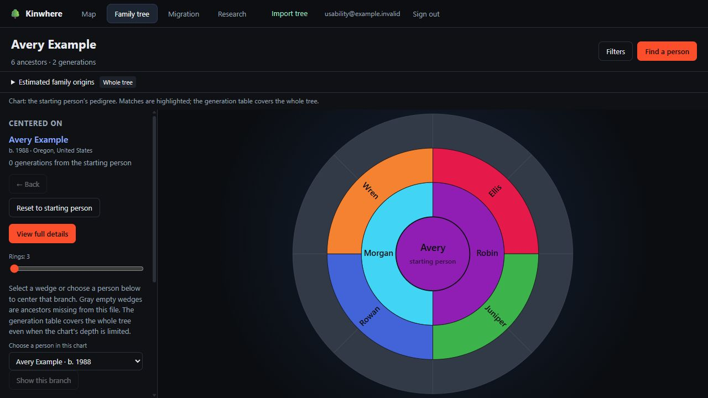
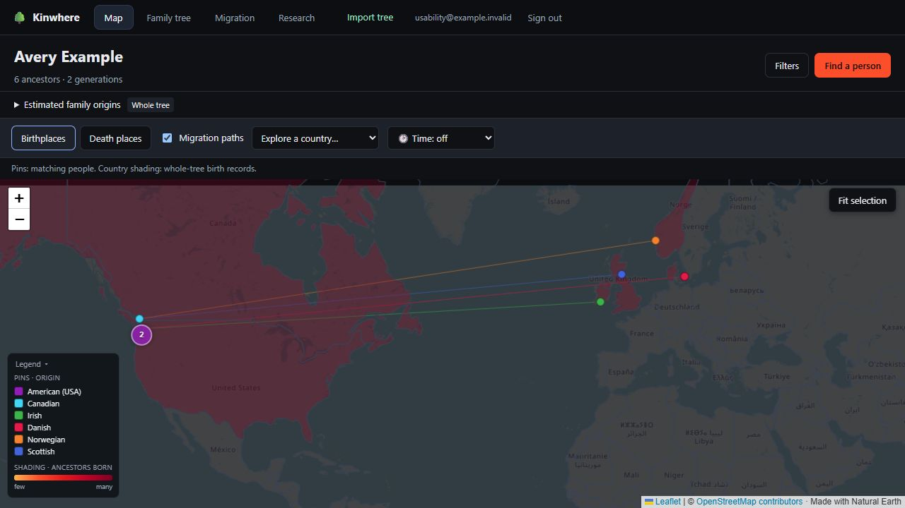
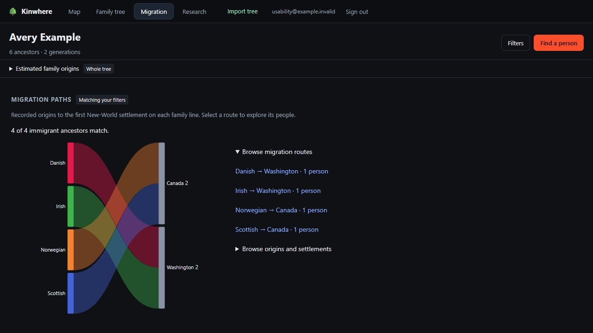

# Kinwhere

Explore the paths that brought you here.

[](https://github.com/connorkeetch/kinwhere/actions/workflows/checks.yml)
[](https://github.com/connorkeetch/kinwhere/releases/latest)
[](LICENSE)

Kinwhere turns a GEDCOM export into an interactive ancestry map, family chart,
migration view, and research hints. Run your own copy with Docker and explore
your records in a browser.

**MIT licensed. No invitation, subscription, FamilySearch password, or AI key is
required to run the app.**

[Get started](#start-your-own-copy) · [What it does](#what-you-can-explore) ·
[Installation and backups](docs/SELF_HOSTING.md) · [Contribute](CONTRIBUTING.md)



## Start your own copy

1. Install and start [Docker Desktop](https://docs.docker.com/desktop/) on Windows
   or macOS, or Docker Engine with Compose on Linux. Use Linux containers.
2. Download the **`kinwhere-*.zip`** asset from the
   [latest release](https://github.com/connorkeetch/kinwhere/releases/latest),
   extract it, and open a terminal in the folder containing `compose.yaml`.
3. Run:

   ```sh
   docker compose up --build -d
   ```

4. Open **[http://localhost:8000](http://localhost:8000)** and create an app account.
5. Choose **Try an example tree**, or **Import my family tree** with a GEDCOM
   (`.ged`) export from your genealogy software.
6. To import, choose your file and select **Find starting person**. Search by
   name, birth year, or birthplace, confirm whose ancestors to explore, then
   select **Import tree**.

The first build can take several minutes. No `.env` file is needed. Accounts,
trees, and the generated session secret are kept in a persistent Docker volume.
The default port is bound to this computer's localhost address.

See [installation, settings, backups, and updates](docs/SELF_HOSTING.md) for the
complete guide. If startup fails, check `docker compose ps` and
`docker compose logs --tail=100 app`. Review logs for private information before
sharing them.

## What you can explore

- **Map:** explore recorded birthplaces, death places, countries, and migration paths.
- **Family tree:** follow family relationships and center the tree on anyone.
- **Migration:** see where recorded immigrant ancestors came from and settled.
- **Research:** find missing people and places, repeated ancestors, and records to check.
- **Find a person:** search names or recorded birthplaces across the tree, open
  person details, or view their family relationships. Recorded places remain
  searchable when they cannot be placed on the map.
- **Optional AI:** infer country labels for unclear place names and suggest
  duplicate records or parent claims, with visible uncertainty labels.

### What to expect

Kinwhere explores GEDCOM exports. Edit records in your genealogy app, then import
an updated file. This is an early release; feedback on different exporters is welcome.

Map pins require latitude and longitude already present in the GEDCOM. Recognized
place names still support country summaries, and recorded places remain searchable
without coordinates. Optional AI infers country labels; it does not add coordinates.
The migration view and immigrant-origin estimate use a U.S./Canada settlement model.

Results describe the records you imported. Ancestral origin percentages are
genealogy calculations, **not DNA-test results**. Missing information stays
untraced. AI judgments and research estimates are labeled separately from
recorded information.

The included [example GEDCOM](web/public/example.ged) is fictional and has no
FamilySearch IDs. Download it from the upload page, or try it directly from Home.
Your own GEDCOM may come from any compatible exporter; see the in-app import guide.

<details>
<summary>See the map and migration views</summary>

All screenshots use the bundled fictional family.





</details>

## Privacy and your data

The default installation stores your data on your computer in its Docker volume.
Each app account can access only its own uploaded trees. The app does not ask
for your FamilySearch credentials. Keep your original GEDCOM as source material.

AI is **off by default**. Setting `OPENROUTER_API_KEY` enables external processing
through OpenRouter: place mapping sends place strings, and parent/duplicate
analysis sends selected names, dates, places, and family relationships. Records
classified as likely living are excluded; that classification depends on import
dates, and missing dates can prevent detection. Keep AI disabled when you do not
want those records sent to an external service.

Country boundaries are bundled. Map tiles come from OpenStreetMap, so the
map still uses the internet and the provider receives connection information and the
requested map area. Other charts and core calculations need no AI service.

**Download analysis (JSON)** exports one structured tree; it is not an
installation backup and cannot be uploaded through the GEDCOM import. Follow
the [backup/restore procedure](docs/SELF_HOSTING.md#back-up-the-full-installation)
to preserve accounts and saved trees. Do not delete the Docker volume during updates.

## Updates and sharing an installation

Back up first, obtain the next release, preserve your private configuration, and
run `docker compose up --build -d` again. Read release notes for compatibility
changes. The [self-hosting guide](docs/SELF_HOSTING.md) covers restoration and rollback.

Anyone can download and run this project. If you expose your installation to
other people, configure HTTPS, persistent storage, and appropriate registration
controls. This is optional; local use needs no invitation.

## Contributing and development

[Report a bug](https://github.com/connorkeetch/kinwhere/issues) using
fictional data, or open a focused pull request. See [contribution guidance](CONTRIBUTING.md)
and the [development and CLI guide](docs/DEVELOPMENT.md).

Do not post real GEDCOMs, databases, backups, API keys, passwords, or identifiable
family information in public issues.

Original project code is [MIT licensed](LICENSE). Dependencies and map data retain
their own licenses; see [third-party notices](THIRD_PARTY_NOTICES.md).
